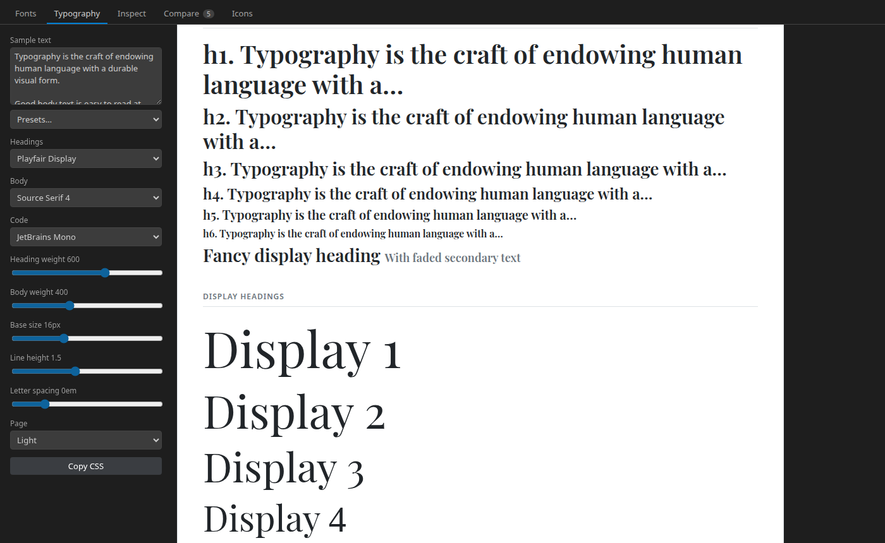
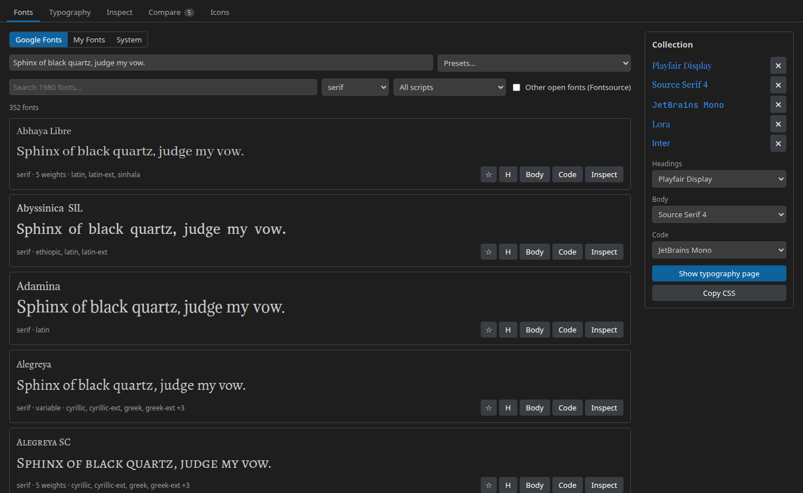
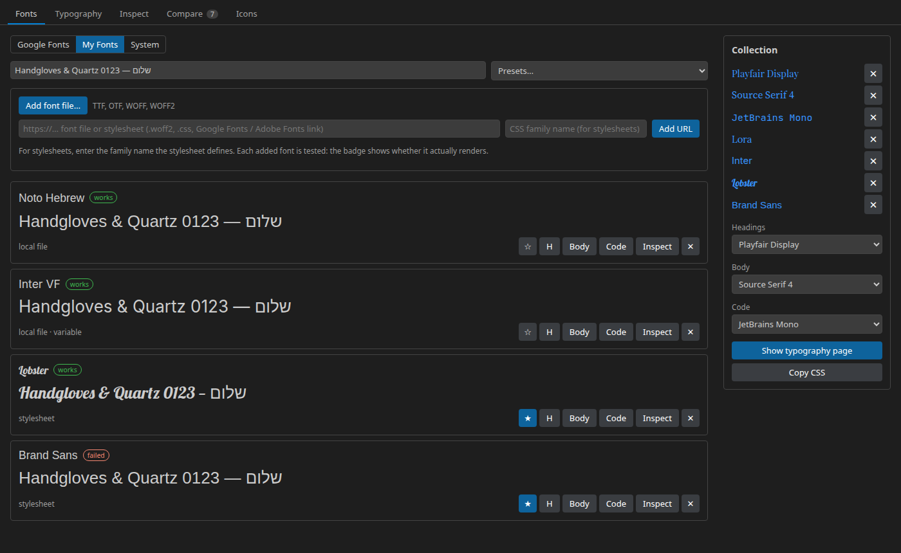
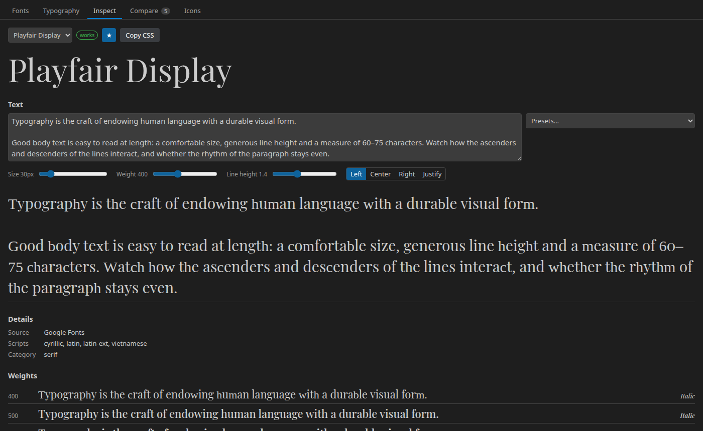
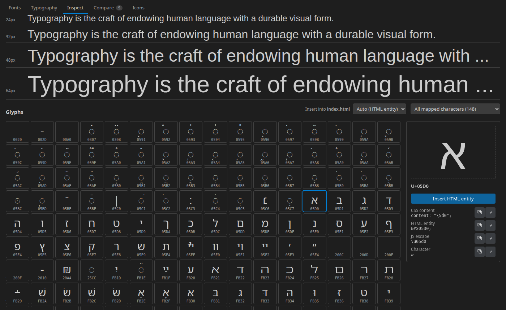
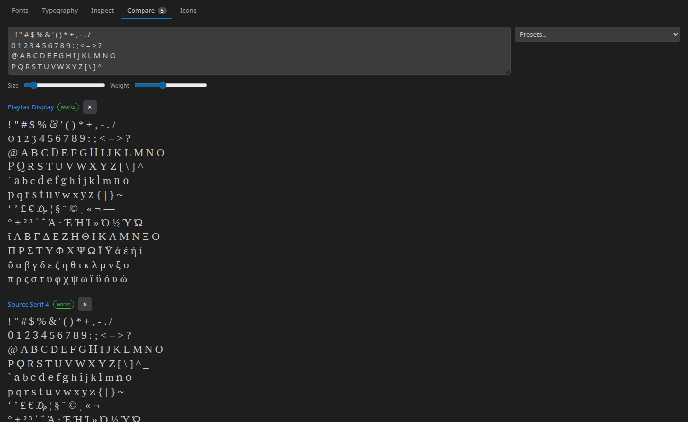
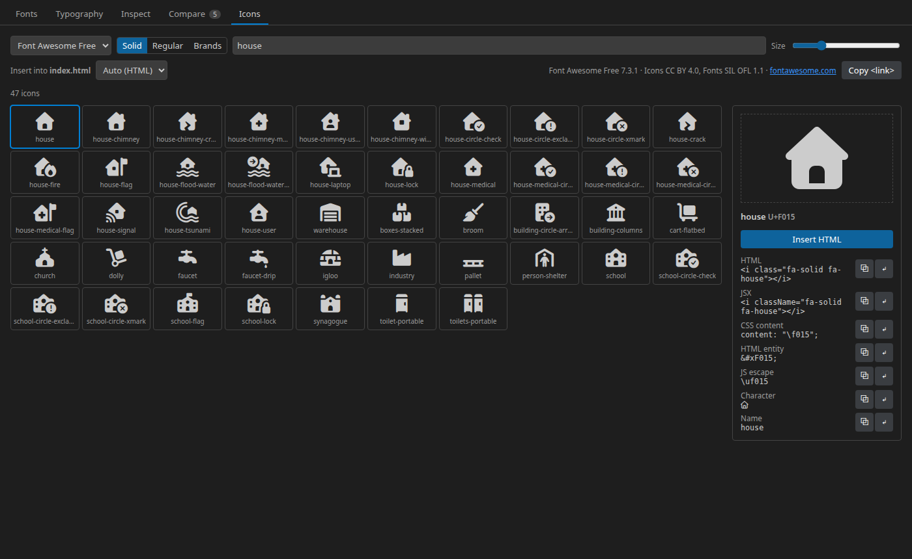

<p align="center">
  
</p>

<h1 align="center">Font Studio</h1>

<p align="center">
  <strong>Find, test and compare fonts and icon fonts without leaving VS Code, and insert icons and glyphs straight into your code.</strong>
</p>

<p align="center">
  <a href="https://marketplace.visualstudio.com/items?itemName=bsesic.vscode-font-preview"></a>
  <a href="https://marketplace.visualstudio.com/items?itemName=bsesic.vscode-font-preview&ssr=false#review-details"></a>
  <a href="LICENSE"></a>
</p>

<p align="center">
  <a href="https://www.buymeacoffee.com/bsesic"></a>
  <a href="https://github.com/sponsors/bsesic"></a>
</p>



## ✨ Why Font Studio?

- 🔤 **All Google Fonts at hand:** search about 2,000 families by name, category and script, with live previews
  of your own text.
- 📰 **See fonts in context:** a Bootstrap-style typography page shows your heading, body and code fonts together,
  and **Copy CSS** gives you the code for it.
- 🧪 **Test any font:** local font files, web font URLs, stylesheets and installed system fonts are checked on
  load, so you know right away whether a font actually renders.
- 🌍 **Built for every language:** multi-line sample text, presets for many scripts and character tables for
  ASCII and 30 8-bit code pages.
- ⭐ **Icon fonts included:** Font Awesome, Bootstrap Icons, Material Symbols, Remix, Lucide, Tabler and
  Phosphor, about 20,000 icons in total.
- 🗣️ **Speaks your language:** available in 14 languages, following the display language of VS Code.
- ⚡ **Insert into your code:** icons and glyphs go to your editor at every cursor, in the right format for
  the file: HTML, JSX, CSS `content` or a JS escape.
- 📦 **Self-host your fonts:** download a font into your project with a ready-made `@font-face` stylesheet.

## 🚀 Quick start

1. Install **Font Studio** from the Visual Studio Marketplace.
2. Click **Fonts** in the status bar or press `Ctrl+Alt+Shift+F` (`Cmd+Alt+Shift+F` on macOS).
   Right-click a `font-family` in your code and choose **Preview Font Under Cursor** to inspect it directly.
3. Star fonts (☆) or assign them with **H**, **Body** and **Code**, then open the **Typography** tab.

Opening a `.ttf`, `.otf`, `.woff`, `.woff2` or `.ttc` file shows it in the preview directly.

## 🎯 Features

### 🔤 Google Fonts browser

Browse every Google Font, with the optional other open fonts from [Fontsource](https://fontsource.org).

- Search by name, filter by **category** (serif, sans-serif, display, handwriting, monospace) and **script**
  (Hebrew, Greek, Cyrillic, Arabic, Devanagari, …)
- Previews load lazily and only fetch the characters they need
- Collect fonts with ☆ and assign them to headings, body text and code
- The font list is cached for 24 hours, so it also works offline after the first start



### 📰 Typography page

A specimen page in the style of the Bootstrap documentation: headings h1–h6, display headings, lead and body
text, inline elements, blockquote, lists, code, table and form.

- Separate fonts for **headings**, **body text** and **code**
- Sliders for heading and body weight, base size, line height and letter spacing
- Light, dark and editor themes
- **Copy CSS** or **Insert CSS** exports the `<link>` or `@font-face` rules and the matching `body`, `h1–h6` and
  `code` styles

### 🧪 Your own fonts, tested

Add fonts from anywhere and see immediately whether they work:

- **Font files:** TTF, OTF, WOFF and WOFF2 from your disk
- **Web font URLs:** a direct link to a font file
- **Stylesheets:** any `.css`, Google Fonts or Adobe Fonts link
- **System fonts:** pick from the installed families or enter a name

Every font gets a badge: `works`, or `failed` with the reason, for example a family name the stylesheet does
not define or a font that is not installed. Added fonts are remembered.



### 📦 Add fonts to your project

**Add to project…** in Inspect downloads a font into your workspace, so your site does not depend on a font
CDN:

1. Choose the weights and styles, then the scripts (subsets)
2. The WOFF2 files and a stylesheet are written to `fonts/<font>/` (see `fontPreview.projectFontFolder`)
3. Insert the `@import` of the stylesheet into your code with one click

The stylesheet contains one `@font-face` rule per file with `unicode-range`, so browsers only download the
scripts a page uses. This works for Google Fonts, Fontsource fonts, your font files and web font URLs.

### 🔍 Inspect

Everything about one font on a single page:

- A large, **multi-line text box** set live in the font, with size, weight, line height and alignment
- **Presets:** pangram, alphabet, punctuation, paragraph, diacritics, Hebrew, Greek and Cyrillic, code
- Metadata of font files and Google Fonts: format, version, designer, license, glyph count, all variable axes
- **OpenType features:** toggle ligatures, small caps, old-style and tabular figures, fractions, stylistic
  sets, kerning and more, then copy or insert the `font-feature-settings` CSS
- All weights, a size waterfall and sliders for **variable font axes**



### 🔣 Glyphs

A glyph grid per Unicode block. It shows exactly the characters the font contains, for font files and for
Google Fonts (read from the complete font file). Select a
glyph to see its code point and insert it as HTML entity, CSS `content`, JS escape or character.



### 🌍 Character tables and Compare

Test languages with character tables for **ASCII** and 30 8-bit code pages, one row per 16 bytes:

| Family | Code pages |
| --- | --- |
| ISO 8859 | -1 Western · -2 Central European · -3 Maltese, Esperanto · -4 Baltic · -5 Cyrillic · -6 Arabic · -7 Greek · -8 Hebrew · -9 Turkish · -10 Nordic · -11 Thai · -13 Baltic Rim · -14 Celtic · -15 Western with € · -16 South-Eastern European |
| Windows | 1250 Central European · 1251 Cyrillic · 1252 Western · 1253 Greek · 1254 Turkish · 1255 Hebrew · 1256 Arabic · 1257 Baltic · 1258 Vietnamese |
| Others | KOI8-R · KOI8-U · CP437 · CP866 · Mac OS Roman · Mac OS Cyrillic |

**Compare** shows all fonts of your collection side by side with the same text, size and weight.



### ⭐ Icon fonts

Browse, search and insert icons from the most popular icon fonts:

| Icon set | Styles | Icons |
| --- | --- | --- |
| Font Awesome Free 7 | Solid, Regular, Brands | ~2,000 |
| Bootstrap Icons | Regular | ~2,000 |
| Material Symbols | Outlined, Rounded, Sharp | ~4,300 |
| Remix Icon | Regular | ~3,200 |
| Lucide | Regular | ~2,100 |
| Tabler Icons | Outline | ~5,200 |
| Phosphor | Regular | ~1,500 |

Search finds icon names and, for Font Awesome, also its search terms. **Copy &lt;link&gt;** gives you the
stylesheet include for your project. Icon fonts you add yourself appear in the glyph grid, in the
*Private Use Area* block.



### ⚡ Insert into your code

Select an icon or glyph and click **Insert**, or double-click it. The text goes to the editor you used last, at
every cursor. **Auto** picks the format from the language of the file:

| File | Inserted |
| --- | --- |
| HTML, Vue, Svelte, PHP, Markdown, … | `<i class="fa-solid fa-house"></i>` |
| JSX / TSX | `<i className="fa-solid fa-house"></i>` |
| CSS, SCSS, Less | `content: "\f015";` |
| JavaScript, TypeScript, Python, … | `` |

You can also choose HTML entity, character or icon name. Every format can be copied too. Without an open
editor, the text is copied to the clipboard.

## 🌍 Languages

Font Studio follows the display language of VS Code (**Configure Display Language**) and is available in:

English · Deutsch · Français · Español · Italiano · Português (Brasil) · 日本語 · 한국어 · 简体中文 · 繁體中文 ·
Русский · Polski · Čeština · Türkçe

Found a translation that could be better? Improvements are welcome, see [CONTRIBUTING.md](CONTRIBUTING.md).

## ⌨️ Commands and shortcuts

All commands are available in the command palette under **Font Studio**. The **Fonts** button in the status
bar opens the preview with one click.

| Command | Shortcut / menu |
| --- | --- |
| Open Font Studio | `Ctrl+Alt+Shift+F` / `Cmd+Alt+Shift+F` |
| Preview Font Under Cursor: inspects the family of a `font-family`, `font` or `fontFamily` declaration, or the quoted name at the cursor | Editor context menu |
| Insert Icon... | Editor context menu |
| Add Font File... | Opens the panel and a file picker |
| Preview Font (explorer context menu of font files) | Opens a font file in the preview |
| Refresh Google Fonts Catalog | Reloads the font list |

## ⚙️ Settings

| Setting | Default | Description |
| --- | --- | --- |
| `fontPreview.sampleText` | pangram (English and German) | Initial sample text |
| `fontPreview.catalogUrl` | `https://api.fontsource.org/v1/fonts` | Source of the font catalog |
| `fontPreview.showStatusBarItem` | `true` | Show the **Fonts** button in the status bar |
| `fontPreview.projectFontFolder` | `fonts` | Workspace folder that **Add to project** downloads fonts into |

Installed system fonts are listed with `fc-list` (fontconfig) when available, otherwise by reading the font
folders of Windows, macOS or Linux.

## 🔒 Privacy

The font catalog is loaded from the Fontsource API. Previews are loaded from Google Fonts (`fonts.googleapis.com`,
`fonts.gstatic.com`) and jsDelivr. Icon set data comes from jsDelivr (pinned package versions) and, for
Material Symbols, from Google's GitHub repository. Local font files never leave your machine.

## ☕ Support

Font Studio is free and open source. If it saves you time, you can support its development:

<a href="https://www.buymeacoffee.com/bsesic"></a>
<a href="https://github.com/sponsors/bsesic"></a>

### 🪙 Crypto

Prefer crypto? Donations are welcome at these addresses:


```text
3C4bVHFd4djqVGSdEiixDLb2JLrXxtLn8E
```


```text
0x4fF1438dfff475fAB092B9Df05b80C7f0De8eae1
```


```text
MGNx1tZKMi6wamnW6bKALZTuei7sGkhe3m
```


```text
DAfwox4hQ7dFB4t914ckMbEiqFYWgHpTwTVyGiy4eo7D
```


```text
429QtMeViydLdK3NZvpWx4P18g3U969pW5Q2eBU2umMqUKbksPsLBwU3DxtbJ4GaXMh7nYJcf5F2m2egLjJUyWSzLZ1hBcH
```

A ⭐ on [GitHub](https://github.com/bsesic/VSCodeFontPreview) or a review on the
[Marketplace](https://marketplace.visualstudio.com/items?itemName=bsesic.vscode-font-preview&ssr=false#review-details)
helps too!

## 🤝 Contributing

Found a bug or have an idea? Open an [issue](https://github.com/bsesic/VSCodeFontPreview/issues).
Want to contribute code? See [CONTRIBUTING.md](CONTRIBUTING.md).

## 📄 License

[MIT](LICENSE) © Benjamin Schnabel

Icon fonts and web fonts shown in the preview keep their own licenses (for example SIL OFL 1.1, MIT, Apache 2.0
or CC BY 4.0). Check the license of a font before you use it in your project.
